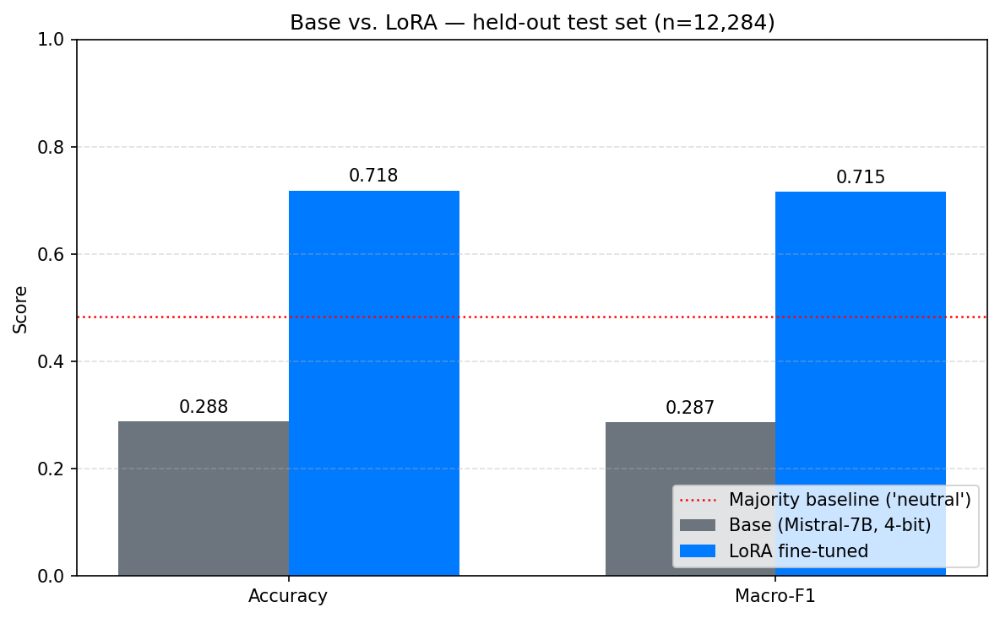

# 🧠 Parameter-Efficient Fine-Tuning: Mistral-7B + LoRA for Tweet Sentiment

> Fine-tuned Mistral-7B with a LoRA adapter (0.58% of parameters) on the `cardiffnlp/tweet_eval` dataset on a free Google Colab T4 GPU. **End-to-end accuracy improved from 28.8% to 71.8% on 12,284 held-out tweets.**

## 📊 TL;DR Results

| Metric | Base Mistral-7B (4-bit) | + LoRA Adapter | Δ (Lift) |
| :--- | :---: | :---: | :---: |
| **End-to-End Accuracy** | 0.2879 | **0.7183** | **+0.4305** |
| **Macro-F1 Score** | 0.2868 | **0.7155** | **+0.4287** |
| Format Compliance | 51.83% | **100.0%** | +48.17 pts |
| Acc *on parseable subset* | 0.5554 | 0.7149 | +0.1596 |
| Majority Baseline (always 'neutral') | 0.4833 | — | — |

---

## 🔍 The Honest Breakdown (Why did it improve?)

The 43-point lift is real, but "LoRA improved accuracy by 43 points" misrepresents what actually happened. The lift decomposes cleanly into two effects:

1. **The Format Effect (+26.75 pts):** Base Mistral-7B is a *completion* checkpoint, not instruct-tuned. On 48% of test examples, it produced free-form text continuations (e.g., `"@user what do these '"`) with no valid class label. LoRA taught it to always output `positive/negative/neutral`.
2. **The Task Effect (+16.30 pts):** On the 51.83% of examples the base model *could* format, accuracy rose from 55.54% to 71.49%. This is the "real" task-learning signal, isolated from format learning.

### 🤯 The "Dummy Classifier" Insight
With a class-imbalanced test set (~48% neutral), a dummy classifier that *always* predicts "neutral" achieves 48.3% accuracy. 
* The **Base model scores 28.8%** — it is **19.5 points WORSE than a dummy classifier** because it wastes 48% of predictions by rambling.
* The **LoRA model scores 71.8%** — it is **23.5 points BETTER than the dummy classifier**. 

LoRA didn't just improve the model; it turned a fundamentally broken pipeline into a deployable one.

---

## 🛠️ Method & Hyperparameters

* **Base Model:** `unsloth/mistral-7b-bnb-4bit` (4-bit quantized)
* **Adapter:** LoRA (Rank `r=16`, `alpha=16`, dropout `0.0`), targeting all 7 projection layers (`q, k, v, o, gate, up, down`).
* **Trainable Params:** 41,943,040 / 7,283,675,136 (**0.58%**)
* **Dataset:** `cardiffnlp/tweet_eval/sentiment` (Subsampled 5,000 train / 2,000 validation / 12,284 test)
* **Training:** 1 epoch, effective batch size 8, `lr=2e-4`, `adamw_8bit` optimizer. Time: ~38 minutes on T4.
* **Evaluation:** Greedy decoding, first-token parser.

## 🚀 How to Run

1. Open the notebook in Google Colab: 
2. Go to **Runtime → Change runtime type** and select **T4 GPU**.
3. Run the cells sequentially from top to bottom.
4. *Note: Total execution time is ~70 minutes (38 mins training + 25 mins evaluation).*

## 💡 What I Learned

* **"Accuracy lift" from LoRA can be misleading:** Isolating format compliance from task accuracy turned a vague "43-point lift" into a precise "27 pts format + 16 pts task" finding.
* **Silent adapter bugs are everywhere:** My first eval run produced *identical* base and fine-tuned predictions. I fixed it by explicitly using `model.disable_adapter()` and adding an assertion gate (`assert n_diff > 0`) to catch it in future runs.
* **Parsers matter:** Handling all 3 classes explicitly in the parser prevents silent degradation of Macro-F1 scores.
